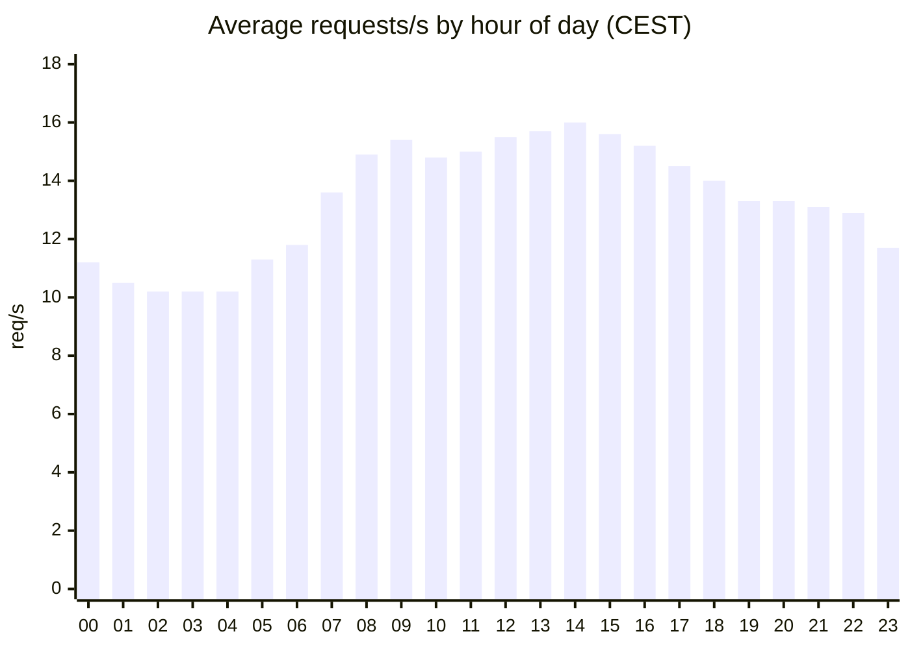
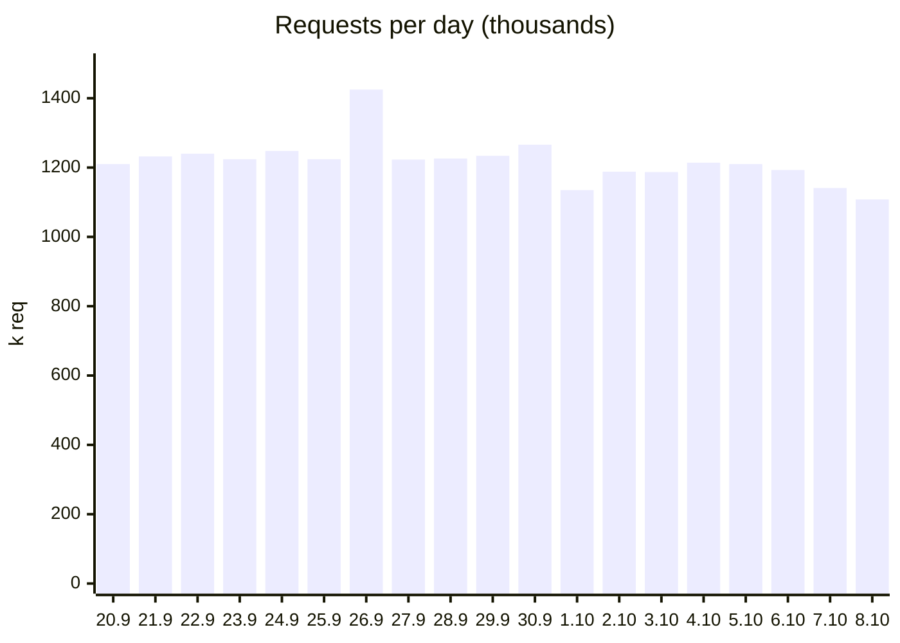

# winds.mobi since 2012?

2016 - lu-glidz.blogspot.com

---

# winds.mobi since 2026-07-15

---
layout: center
class: text-center
---

# The hardware

1 VPS

**2 vCores - 4 GB RAM - 80 GB SSD - Ubuntu**

OVH "low cost" VPS for **9.50 EUR / month**

API, scrapers, admin, MongoDB, Postgres, Redis - all on the same box.

~35 M requests / month = <b>~0.27 EUR per million requests</b>

<!--
Not a DB-as-a-service, no autoscaling, no replicas.
-->

---

# Data in

3,500+

stations

~3,200

reported in the last hour

5 min

refresh interval

| Provider | Stations |
|---|---:|
| METAR (airports) | 1,000+ |
| holfuy | 820 |
| pioupiou | 698 |
| FFVL | 490 |
| SLF | 203 |
| MeteoSwiss | 155 |
| 13 others | ~150 |

<!--
Snapshot from the public API on 9 Oct 2026. METAR is capped at 1000 by the API's limit, real number is higher.
Rough write load: ~3,200 live stations / 300 s = ~10 station updates per second into MongoDB (estimate).
-->

---

# Data out

1.2 M

requests / day

~18,900

unique visitors / day (IP + user agent)

7.2 GB

out / day

0.003 %

5xx error rate (720 of 24.2 M)

<!--
Full report window 19 Sep - 9 Oct: 24.2M requests, 151 GB, 378k visitor-days.
Daily numbers use the 19 full days only.
-->

---

# Requests per second

14 rps
average

16 rps
busiest hour (14:00)

<!--
Caveat: GoAccess only gives hourly buckets aggregated over the window, so these are averages.
True per-second peaks are unknown until OpenTelemetry metrics are re-enabled.
The night floor is ~65% of the daytime peak - that is the machines, not the pilots.
-->

---

# Requests per day

---

# Humans vs machines

| User agent family | Requests | Share |
|---|---:|---:|
| Unknown / empty UA | 11.6 M | 48 % |
| Crawlers & apps (CFNetwork, Python, ParaRidge, ...) | 7.9 M | 32 % |
| Browsers (Chrome, Safari, Firefox, Edge, ...) | ~3.7 M | 15 % |
| HTTP libraries & others | 0.3 M | 1 % |

The API Terms of Use ask every client to **identify itself** - most do, but not all.

<!--
Browsers are ~15% of requests but the majority of bytes.
-->

---

# Where are the users?

| Continent | Requests / day | Share |
|---|---:|---:|
| Europe | 986 k | 81.0 % |
| North America | 131 k | 10.8 % |
| Asia | 39 k | 3.2 % |
| South America | 22 k | 1.8 % |
| Oceania | 21 k | 1.7 % |
| Africa | 17 k | 1.4 % |

| Country | Requests / day | Share |
|---|---:|---:|
| 🇫🇷 France | 334 k | 27.4 % |
| 🇨🇭 Switzerland | 231 k | 19.0 % |
| 🇩🇪 Germany | 153 k | 12.6 % |
| 🇺🇸 United States | 89 k | 7.3 % |
| 🇳🇱 Netherlands | 41 k | 3.4 % |
| 🇮🇹 Italy | 38 k | 3.1 % |

---

# What's next: wind alarms

---

# What's next: wind alarms

---
advanceAfterVideo: 5
advanceAfter: 40 # fallback if the video never plays (it is 14 s long)
---

# What's next: your own data sources & data views

<SlidevVideo autoplay autoreset="slide" muted class="rounded shadow h-[21rem] mx-auto mt-2">
  <source src="/data-views.mp4" type="video/mp4" />
</SlidevVideo>

---
layout: center
class: text-center
hideDiscordQr: true
---

# Join our community on Discord

Discuss new features, report bugs, share ideas

Code & issues: [github.com/winds-mobi](https://github.com/winds-mobi)
